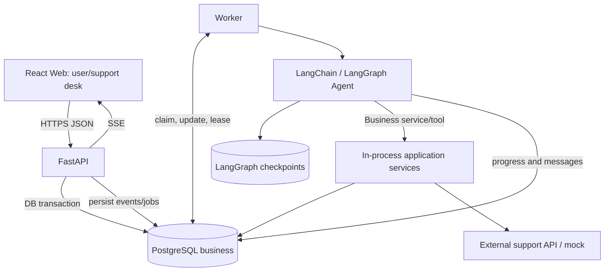
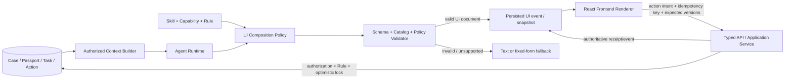

# 售后通 · 系统架构 V1

## 1. 已选技术

- **Web**：React + TypeScript + Vite；Tailwind / shadcn/ui 在 UI 基线实施阶段加入。React Router、TanStack Query 管理路由与服务端状态。
- **API**：Python、FastAPI、Pydantic、SQLAlchemy、Alembic；建议按业务模块拆 `APIRouter`。
- **Agent**：LangChain `create_agent` 作为 Agent Loop；LangGraph Postgres Checkpointer 用于可恢复执行，按需显式编排需要暂停/分支的业务工作流。保留 Provider Adapter 而非绑定某个模型。
- **Database**：生产 PostgreSQL（目标 AWS RDS）；独立数据库 Schema 管理业务数据和 LangGraph 持久化表。
- **Worker**：同一 Python 工程，不同进程，任务队列初版采用数据库状态表 + 租约、重试与幂等；Agent 执行脱离浏览器 HTTP/SSE 生命周期。
- **文件**：本地适配器（开发）/ S3（生产），数据库仅存元数据和安全对象引用。
- **实时**：REST 发命令、SSE 推送公开业务事件和 Agent 进度，事件序号供断线恢复；如果需要复杂双向 presence 再评估 WebSocket。
- **部署**：EC2：Web 静态站、API、Worker 与反向代理；RDS Postgres；S3 可选。暂不默认使用 Kafka、Kubernetes、Redis、Celery。

## 2. 进程视图

其中 `A2` 是 Worker 进程中复用的 Python 业务服务，不代表必须通过 HTTP 回调 API 进程。禁止绕过业务层直接让 Agent 修改设备、Case 或会话记录。

## 3. 领域边界与代码依赖方向

`API router -> Application service -> Domain + Ports -> Repository/Integration adapters`

`Agent runtime -> typed tools -> Application service`；业务模块不得反向 import Agent 运行实现。

- `conversations`: 消息、公开/内部范围、会话状态、发言权校验
- `collaboration`: 人工分配、工作委派、审批、协作模式切换
- `cases`: 具体问题、证据、处理进度、可核验解决结果
- `devices`: 设备身份、历史服务事实、来源与核验
- `memory/context`: 检索与压缩经授权的相关上下文；不得直接把推测写成设备事实
- `agents`: runtime、tools、skills、stream adapter、运行限制
- `jobs/events`: 可靠队列、审计事件与跟进

## 4. 最关键的写操作边界

1. 模型输出 `ActionProposal`，并不直接构成公开消息或成功业务动作。
2. 发布公开消息前，由 Conversation Service 根据当前版本与权限**再次校验**。
3. 动作经 Action Gateway 验证权限、业务前置条件、幂等键；必要时等待人工批准。
4. 外部调用必须记录回执；超时且无法判断外部是否执行时，进入 `UNKNOWN` 并查询对账，**不能盲目重复执行**。
5. `interrupt()` 所在节点在恢复时从节点起点重新进入，任何不可重复副作用必须在恢复后再以幂等方式执行。

## 5. 消息与事件可靠性

- 用户提交时使用 `client_message_id` 做去重。一个事务内保存消息 + `outbox_events` + 待执行任务。
- Worker 领取任务使用数据库锁/租约；需要重试、心跳、死信或失败状态。 `SKIP LOCKED` 可用于队列行领取，但不能保证下游 exactly-once；必须业务幂等。
- Public events 与 Internal events 分通道或分权限检查，不可把 Agent 内部草稿推到用户可订阅 SSE。
- 大量 token 流属于短暂展示事件；每个已完成的公开消息完整落库。断线后先读取快照、再增量补取持久事件。
- Nginx 应对 SSE 禁止缓冲，配置足够的读写超时，前端支持取消订阅与重连退避。

## 6. 速度策略

- 快速确认接收与长执行解耦；不在 API 请求中等待 LLM 完成。
- 主动拆分时间指标：`client_ack_ms`、`http_accept_ms`、`queue_delay_ms`、`model_ttft_ms`、`first_visible_progress_ms`、`tool_latency_ms`、`end_to_end_ms`。
- 稳定 Prompt / 工具定义优先缓存；按需上下文，独立查询可并行；限制最大 Agent 步数与 Tokens。
- 后端同步回复保留身份/政策规则保护；不因性能目标跳过授权与业务条件。

## 7. 生产安全边界

- 用户与客服的认证和授权在 API 层；服务层再次按 tenant/customer/staff/role 做资源级授权。
- 聊天文本、上传照片、检索材料都作为不可信输入；不得把其中的命令提升为系统指令。
- 图片先验证格式/大小、扫描存储，不允许任意 URL 下载到服务端；S3 用预签名方案时限制对象 Key 与访问范围。
- 不在 Trace、前端事件、SOP 文档里泄露密钥、完整购买凭证/序列号、敏感身份数据。
- 生产配置不提供“绕过认证”的默认开关；开发时使用受限且显式的本地测试账号模拟。

## 8. Agent → UI Schema → Frontend Renderer

### 8.1 设计边界与数据流

Generative UI 是 Agent Runtime 的一个受控输出通道，不是让 Agent 接管前端，也不是新增业务写入口。

执行顺序：

1. Context Builder 按租户、角色、Conversation/Case 关联、事实状态和数据最小化读取权威数据。
2. Runtime 根据 Case 阶段和 Agent 任务判断是否需要动态 UI；纯解释性回答可以只输出文本。
3. UI Composition Policy 根据当前 Skill、Rule、风险与目标客户端 Catalog，限制可用组件、字段与 action intent。
4. 服务端对完整 UI 文档做 JSON Schema、Catalog、引用、可见性、长度、深度、可访问性和策略校验；失败则降级，不把未校验内容发给前端。
5. 通过的 UI 文档以不可变 revision 和 PUBLIC/INTERNAL 可见性发布；前端 Renderer 将类型映射到仓库内 React 组件。
6. 用户交互只产生 action intent。API/Application Service 重新读取最新权限和对象版本，校验幂等、前置条件与审批，再返回权威状态或真实回执。

### 8.2 各层职责

| 层 | 负责 | 不负责 |
|---|---|---|
| Context Builder | 形成角色化 Case/Device/Conversation/Task/Action View Model，保留来源与版本 | 下发原始推理、无关内部备注、未授权设备历史 |
| Agent Runtime | 判断何时需要组件、选择组件意图和内容层级 | 生成 HTML/JS、直接绑定 API URL、决定最终授权 |
| Skill/Capability/Rule | 约束必需输入、风险、成功条件、失败出口和可用组件 | 提供可执行 UI 代码、扩大 Agent 工具权限 |
| UI Composition Policy | 将业务意图映射为受限 Schema，执行 audience/Catalog/动作白名单规则 | 写 Case、执行工具或发布公开消息 |
| Schema Validator | 拒绝未知组件/字段/数据源/动作、越权可见性、超限嵌套和过期引用 | 代替业务服务的执行时授权 |
| Frontend Renderer | 安全渲染、客户端表单校验、可访问性、未知组件降级和提交 intent | 信任 `permissions` 完成鉴权、从 Schema 执行代码或任意网络请求 |
| Application Service | 执行动作时做最终授权、乐观锁、Rule、审批、幂等和回执 | 信任旧 UI 卡片或模型声称的状态 |

### 8.3 受控组件目录

组件由前端实现并由 Catalog 版本标识，Schema 只引用类型。V1 建议限制为：

- 展示：`CaseSummaryCard`、`EvidenceSummary`、`DiagnosticSteps`、`RiskAlert`、`ProgressTimeline`、`ReceiptCard`；
- 采集：`QuestionForm`、`ChoiceGroup`、`EvidenceUpload`、`VerificationForm`；
- 协作：`SkillRecommendation`、`DraftReview`、`ApprovalPrompt`、`HandoffSummary`；
- 操作：`ActionBar` 中的受控 action intent。通用按钮不能携带任意 endpoint、method、script 或跳转地址。

组件 props 只含可序列化展示值、受控枚举、业务引用和绑定键。富文本仅允许经统一 sanitizer 处理的受限 Markdown；图片只引用文件服务返回的安全对象，不允许 Schema 指示服务端下载任意 URL。

### 8.4 Schema、数据与动作分离

- **结构**：组件树/列表及布局提示，受 Catalog 约束。
- **数据**：服务端生成的最小 View Model 或受控 `data_source` 引用；Renderer 不按模型字符串拼接查询。
- **动作**：稳定 `intent` 映射到类型化应用命令；请求携带 `ui_id`、`revision`、`action_id`、`client_action_id`、`expected_case_version`/`expected_conversation_version` 和表单值。
- **权限**：Schema 中的 `permissions` 只决定是否展示/禁用及解释原因。执行授权仍在服务端，并对过期 UI 返回 409 和最新可恢复状态。

UI 文档本身不复制业务状态机。`ProgressTimeline` 等组件从 Service Case、Service Task、Agent Run、Approval 和 ActionRecord 的当前投影获得数据；Schema revision 与 Case version 分开递增。

### 8.5 发布、恢复与可观察性

- UI 文档应有稳定 `ui_id`、递增 `revision`、`schema_version`、`catalog_version`、audience、来源 AgentRun、上下文对象版本、过期时间和文本 fallback。
- 可恢复的 UI snapshot/revision 经业务事件持久化；SSE 只负责低延迟通知。断线后客户端先读取快照，再按 sequence 追事件。
- 更新使用“发布新 revision / supersede 旧 revision”，不让模型局部修改浏览器 DOM。旧 revision 可展示为历史，但动作默认失效。
- 公开 UI 必须和公开消息一样经过 Conversation Service 的最新 `collaboration_mode`、`reply_policy` 和可见性检查；INTERNAL UI 不进入客户订阅。
- 建议增加 `ui_schema_validation_error_rate`、`ui_fallback_rate`、`ui_action_rejected_stale_rate`、`ui_action_completion_ms` 和无障碍失败率；不得用组件已渲染代替业务完成指标。

### 8.6 与现有实现的冲突和衔接

1. 当前 `AgentRuntime.invoke()` 只返回文本，需未来增加独立结构化输出，不应从自然语言解析组件。
2. 当前 Context Builder 尚未覆盖 Evidence、ServiceTask、Approval、ActionRecord 和 Skill 执行状态；没有这些权威数据前，不生成相应完成/审批卡。
3. 当前 React 前端只有固定消息界面和轮询，没有 Renderer、SSE 或组件 Catalog；产品文档中的动态卡片均未实现。
4. 已归档的旧 A1229 原型采用单设备 Case、内嵌消息和 Runtime 直接写状态，不符合 V1，不能直接作为 UI 数据源。
5. 阶段 2 的 Worker/Agent 基础代码与离线数据库验收已经存在，但真实 Provider、多轮质量和强制中断恢复演示仍未验收；Generative UI 的实施不得被计入当前完成范围。

### 8.7 外部模式的采用范围

- 采用 OpenAI/AI SDK 的“结构化工具结果映射到预建组件”和 UI 失败可降级原则。
- 采用 Adaptive Cards 的版本化 JSON、宿主渲染与唯一 action 标识原则。
- 采用 A2UI 的声明式协议、受信 Catalog、结构/数据分离和增量 revision 思路。
- 不引入远程可执行组件、通用页面 DSL、任意 iframe 或第二套 Agent Runtime；未来是否兼容 A2UI 由实际跨端需求另行评估。

## 9. 主要设计依据

参见 [设计来源说明](references.md)。FastAPI 原生 `APIRouter` 支持模块化；Dify/Onyx 是前后端+Worker 的组织参考；Chatwoot 是会话与接管的业务参考。
