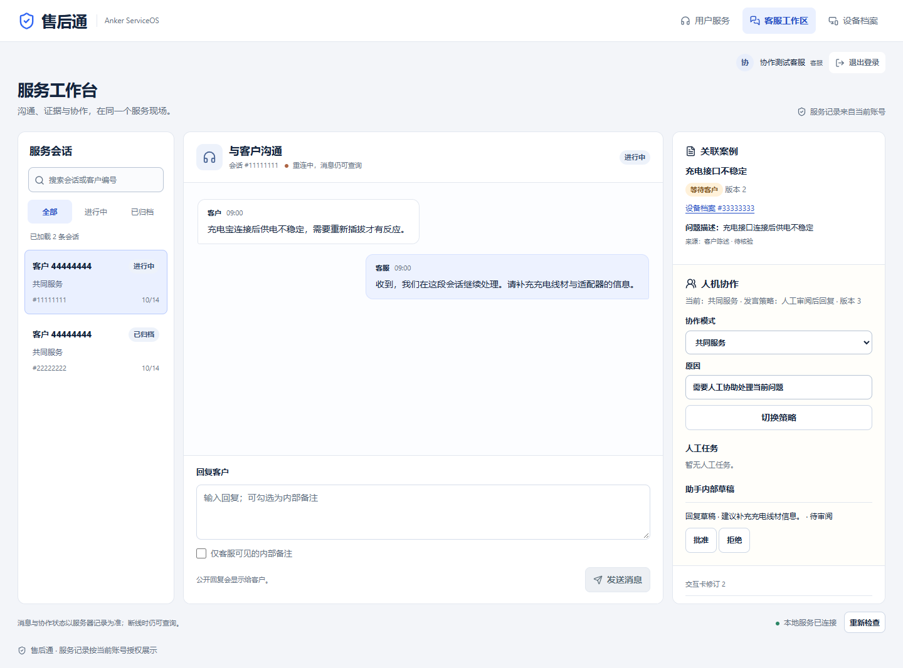
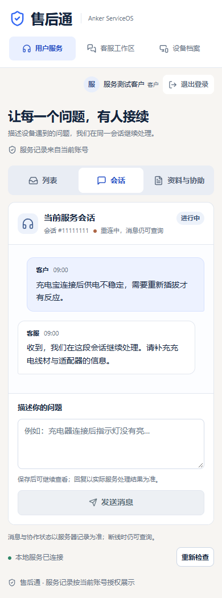
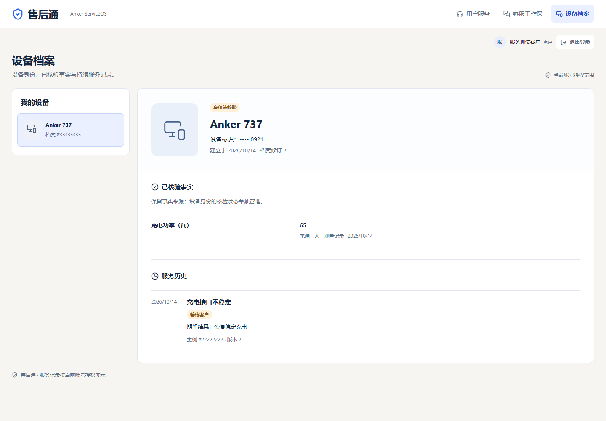

# 基于后端的完整前端适配记录

日期：2026-10-14。基于 `main` 的 `80257de`，在 `codex/frontend-phase3-integration` 继续；此前 `f0d1780` 已完成 409 恢复，本次扩展页面与真实读取能力。验收范围是当前已实现后端，不包含阶段 4/5 或生产部署。

## 页面与真实数据

| 页面 | 功能与数据边界 |
|---|---|
| `/desk` | 三栏会话工作台、已加载会话搜索/状态筛选、公开回复/内部备注、案例来源与核验状态、设备档案跳转、任务接管、模式切换与内部草稿审阅 |
| `/support` | 连续服务会话、受理后同步、原消息幂等重试、人工协助、后端发布的交互卡；手机入口明确标为“资料与协助” |
| `/devices`、`/devices/:id` | 使用三个现有 GET 读取授权设备、已核验事实、关联案例历史；型号与序列号来自服务器，序列号默认显示末四位，身份待核验独立于已核验事实 |

所有活动类型仍来自真实 `contracts/openapi.json`。本次没有修改后端业务代码、迁移、实际 OpenAPI 或生成 Schema；没有接入 `planned` API。未实现的附件、外部售后动作、结果核验和跟进不做可成功提交的按钮。

信息层级沿用参考图与现有蓝白品牌。桌面降低顶部占用并保留列表/沟通/协作；手机保留输入，并通过视图切换查看列表或辅助资料。没有添加虚构 AI 解决率、业务统计、诊断或完成进度。

## 适配中的功能修复

- 草稿文本与 INTERNAL 选择按会话 ID 分别保存。原代码切换会话会沿用同一份输入，本次先复现失败，再修复并验证。
- 模式切换与草稿审阅原因长度统一为后端要求的至少三字，提交使用 trim 后内容；不符合条件时禁用按钮。
- 保留 409 的服务器拒绝原因与主动刷新，403 不假成功；不自动重放业务操作。
- 设备明确 ID 读取失败时显示拒绝，不能默认为列表第一台；查询键包含租户及账号，详情错误不显示旧设备数据。
- 已知事实键提供中文名称（例如 `charging_watts` 为“充电功率（瓦）”）；未知键和值保持原样，不推断诊断。事实来源与日期保留。

## 已执行的本机验证

| 命令/检查 | 结果 |
|---|---|
| `npm run check:api` | 生成 Client 与实际 OpenAPI 一致 |
| `npm run typecheck` | 应用、受控测试、Live 测试及两个配置通过 |
| `npm run build` | 成功；JS 342.44kB，gzip 106.97kB，CSS 17.49kB |
| `$env:PLAYWRIGHT_CHANNEL='chrome'; npm run test:browser` | 19 passed，含原七个冲突/成功/拒绝用例与新增适配回归 |
| 六个 axe 矩阵 | `/desk`、`/support`、设备详情各 1440×1000 和 390×844；WCAG A/AA 无 violations |
| `python -m serviceos_api.export_openapi --check` | 实际路由与契约一致 |
| `python contracts/proposed/v1/sync_implemented.py --check` | 实际契约与提案来源同步 |
| Impeccable detector | `detect --json frontend/src` → `[]` |
| 独立代码审阅 | CI 初始化数据库原先不符合后端 bootstrap 保护条件；已改为独立回环 `serviceos_dev`，后端保护条件未放宽 |
| 独立界面审阅 | 发现手机人工协助标签不明确、事实显示原始字段；集中修复后两项均 scored resolved，disposition ship；仅针对这批修复的判定 |

首次适配回归在原界面上复现了搜索、草稿隔离、手机切换、审阅原因验证和设备页缺失；原移动页面也有对比度问题。首次生成后另查出测试设备拦截错误命中了页面导航（不是 API），修正为 `/api/v1/devices/...` 后验证实际拒绝路径。手机切换按钮文字对比度曾为 4.37:1，修正后 axe 矩阵通过。

## 真实后端浏览器验收

`frontend/tests-live/service-flow.spec.ts` 不拦截 API、不模拟业务响应。CI 使用自身 PostgreSQL 17 服务创建固定 `serviceos_dev`，迁移、开发身份初始化后，启动真实 API 与 Vite 8000/5173。身份来自现有开发登录和 HttpOnly Cookie；测试只写入隔离数据库中的合成资料。

两条路径分别验证：

1. 客户建立会话、发送消息取得 202、刷新后从服务器恢复；客服看到同一记录、接管人工任务、切换 HUMAN_LEAD、保存内部备注、公开回复；客户看不到内部备注且不能使用 `/desk`。
2. 用已有 API 创建测试设备/案例并关联，所有者在页面读取设备身份与服务历史；另一个客户、另一租户读取指定设备被拒绝。

本机没有 PostgreSQL，未运行这两条 Live 流程；其结果以 [PR #3 的实际 Actions](https://github.com/yassay1/anker-serviceos/pull/3/checks) 为准，不能用受控回归替代。测试中的正常事件连接/页面更新不构成 SSE 强制断线与序号补取验收。真实模型 Provider、审批旧 Agent 运行、外部动作与生产身份仍保留原待验状态。CI 输出截图与失败 trace 以 `frontend-browser-evidence` artifact 保存七天。

## 变更文件

应用：App、ServicePage、queryKeys、api/client、conversation 组件、CollaborationPanel、StatusBadge、DevicesWorkspace、两份 CSS。依赖只增加 Lucide 与测试用 axe。验证：workspace fixtures/spec、既有 collaboration spec 文案/手机入口、Live config/spec、测试类型配置和 CI。文档：PRODUCT/DESIGN/设计 sidecar、适配规格/计划、README 与本记录。

## 截图

下图由当前真实页面和 Client 渲染，HTTP 响应为**合成受控测试数据**，仅说明布局、状态及可访问性，不作为真实后端业务/客户资料的证据。

