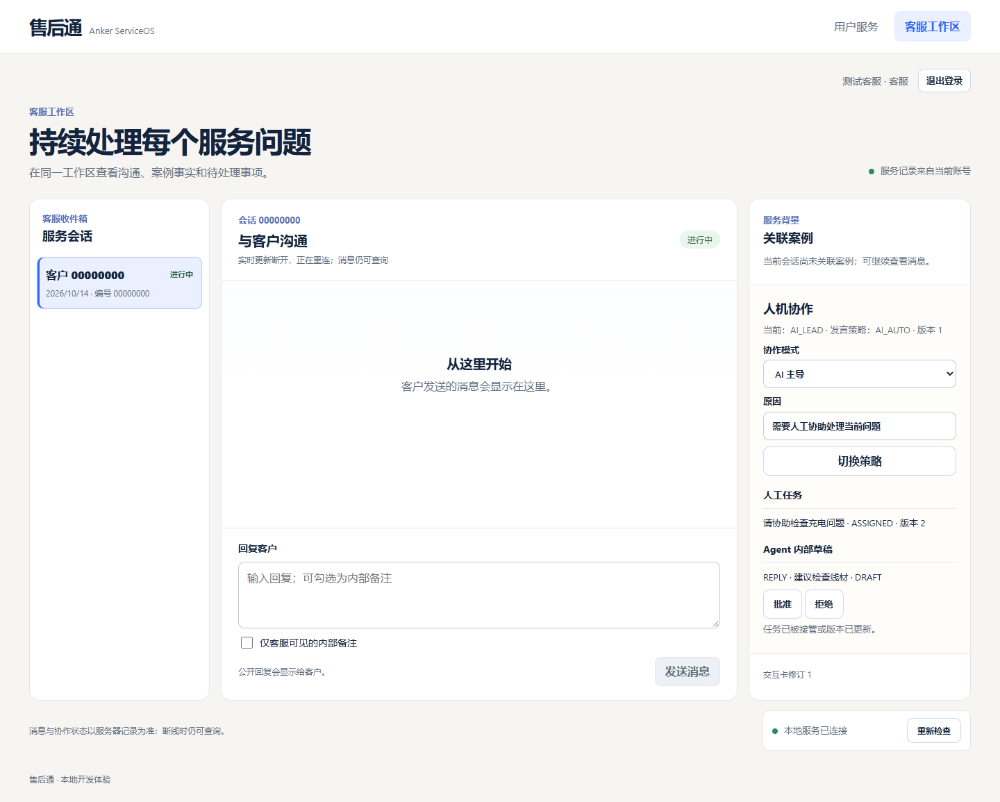
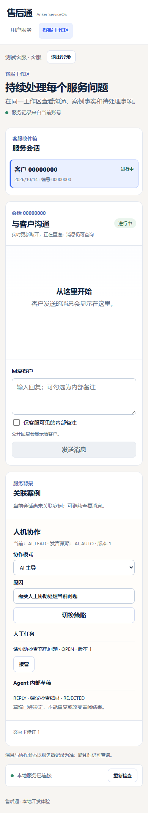

# 前端契约适配与冲突恢复验证

日期：2026-10-14。源基线：`main` / `80257de`。工作分支：`codex/frontend-phase3-integration`。

本次在现有 `frontend/` 上继续，复用登录、资源权限、生成 Client 和 `/support`、`/desk`。独立的展示原型不是业务数据源。本次不改后端服务、路由、数据库迁移、实际 OpenAPI 或生成类型，不新增阶段 4 能力，也不进行部署。

## 当前对接边界

实际后端是 FastAPI/Python 3.12，业务数据库是 PostgreSQL；React 前端通过同源 `/api/v1` 调用，开发时由 Vite 代理到回环 API。身份来自 HttpOnly 会话 Cookie；生产身份源与部署仍待实现。Agent Worker 是另一个进程，健康接口不代表模型在运行。

当前 `contracts/openapi.json` 有 31 个路径、39 个 HTTP 操作。活动 Client 仅从这份真实契约生成，`contracts/proposed/v1` 的 `planned` 操作不进入应用。

| 业务交互 | 现有调用与结果边界 |
|---|---|
| 登录与身份 | `/local-auth/login`、`/auth/me`、`/auth/logout`；客户/客服及租户权限由服务端判定 |
| 会话与消息 | `/conversations`、`/conversations/{id}/messages`；消息带 `client_message_id`，202 表示持久受理，不表示 Agent 已完成 |
| 人工协助 | `/assistance-requests`、`/tasks`、`/tasks/{id}/claim`；领取带 `expected_version`，409 表示拒绝旧状态 |
| 发言策略 | `/mode-transitions`；模式、发言策略、期望版本一同提交，公开发言以最新后端授权为准 |
| 内部草稿 | `/proposals`、`/proposals/{id}/decision`；这是草稿审阅，批准不等于外部售后动作执行 |
| 事件与交互卡 | `/events`、`/event-history`、`/ui-document`、`/ui-document/refresh`、`/ui-actions`；按身份过滤，提交带卡片修订与幂等键 |
| 案例与设备 | 后端已有独立 Case、Device 资源；现有 `/desk` 消费授权案例摘要，不将会话当作设备档案 |

表中路径均以 `/api/v1` 为前缀；会话级路径还包含 `/conversations/{id}`。上传图片、外部动作审批/回执、结果核验、后续跟进属于阶段 4 的计划范围，尚不可通过活动 Client 调用。

## 本次修复

实时事件连接不可用时，任务被其他人领取、协作策略版本更新或草稿被其他人审阅后，当前写请求会收到服务端 409。原前端只展示错误，任务及草稿仍保留过期操作，策略也不能立即恢复到最新版本。

`CollaborationPanel.tsx` 现在保留拒绝原因，并重新查询当前身份可见的会话、任务、草稿与交互卡。已接管任务或已决定草稿不再保留旧按钮；策略选择恢复服务器值，下一次手动提交使用新版本。不自动重放任何写请求。403 继续显示服务端拒绝；409 不被解释成成功。

增加 `.gitattributes` 固定 `contracts/openapi.json` 的 LF 换行。原 Windows `core.autocrlf=true` 将 3656 个换行转为 CRLF，使提案哈希检查失败。归一化 LF 的 SHA-256 与 Git 中原文件及提案记录一致：`9be79d87843b237c14f0ec3cfba4031e2ba4af5fc71ab736e085d5be3665eb49`。这不更改接口内容或提案设计。

## 实际执行的验证

| 检查 | 命令与结果 |
|---|---|
| 锁文件安装 | `cd frontend; npm ci` → 成功，审计 0 vulnerabilities |
| 实际路由与契约 | `backend/.venv/Scripts/python.exe -m serviceos_api.export_openapi --check` → matches actual application |
| 提案来源同步 | `backend/.venv/Scripts/python.exe contracts/proposed/v1/sync_implemented.py --check` → matches actual OpenAPI and planned additions |
| 前端 Client | `npm run check:api` → API types match OpenAPI |
| 类型 | `npm run typecheck` → 应用及浏览器测试类型检查通过 |
| 构建 | `npm run build` → Vite 83 modules，成功 |
| 浏览器回归 | `$env:PLAYWRIGHT_CHANNEL='chrome'; npm run test:browser` → 7 passed |
| 无数据库后端回归 | Python 3.12.14，`pytest backend/tests/test_api_baseline.py backend/tests/test_proposed_openapi_sync.py backend/tests/test_ui_catalog.py -q --basetemp <新建的项目内临时路径>` → 8 passed |
| 改动格式 | `git diff --check` → 通过 |

首次无数据库 pytest 的断言执行结束后，清理系统 Temp 中已有的 `pytest-current` 时遇到 Windows 权限错误。改用新建的项目内 `.runtime/pytest-<唯一标识>` 后，完整命令退出 0。首次指定临时路径缺少父目录也曾导致 fixture 初始化失败；建立父目录后复验通过。未删除或修改系统 Temp 中他人的测试目录。

浏览器测试先在原代码执行：接管冲突、模式过期、草稿已决定三个用例失败，成功/拒绝三个控制用例通过。仅修复冲突刷新后，六个用例全部通过；独立审阅另发现同模式只更新版本时选择框不恢复，新增第七个用例先复现失败，修复后七个用例全部通过。测试使用真实页面、Client 和缓存逻辑，在 HTTP 边界注入当前生成类型对应的响应，并中断测试 SSE；这些是**前端受控回归，不是真实后端端到端联调**。

浏览器路径：`/desk?conversation=00000000-0000-4000-8000-000000000001`，独立测试服务器 `127.0.0.1:5174`。日常开发仍使用 5173，后端 Origin 策略未放宽。测试包括：

- 接管收到 409 后显示 ASSIGNED，旧按钮移除，只发一次领取请求。
- 策略收到 409 后显示服务器模式/版本，下一次手动提交带新版本。
- 服务器模式未变、仅版本更新时，选择框也恢复服务器值。
- 390px 窄屏用 Enter 审阅，收到 409 后显示已有拒绝结果，旧审阅按钮移除；无页面横向溢出。
- 发言策略拒绝批准时，仍为 DRAFT，显示服务端拒绝原因。
- 403 接管拒绝不显示成功或 ASSIGNED。
- 接管成功路径保持正常。

下面截图含合成测试身份、数据及受控响应，不能作为数据库、权限或模型运行证据：

## 影响文件与未验收项

- 行为：`frontend/src/features/collaboration/CollaborationPanel.tsx`。
- 回归：`frontend/tests/collaboration.spec.ts`、`frontend/playwright.config.ts`、`frontend/tsconfig.browser-tests.json`。
- 依赖与命令：`frontend/package.json`、`frontend/package-lock.json`；只有测试所需开发依赖增量。
- 工程：`.gitattributes`、`.gitignore`、`.github/workflows/ci.yml`；CI 增加测试类型校验与 Chromium 浏览器回归。
- 文档：前端 README、本记录、阶段 3 补充记录、实施计划及两张合成数据截图。

本机未运行 PostgreSQL 业务回归、数据库迁移、两个真实客服会话的并发领取、真实持久 SSE 的断线补取或模型 Provider。原阶段 3 记录中的 65 项数据库测试是此前维护者的验证结果，不是本次本机结果。CI 结果须以该分支实际 GitHub Actions 记录为准。完整阶段 3 浏览器验收和阶段 2 Provider 验收继续保持待验；后端部署由维护者后续安排。
