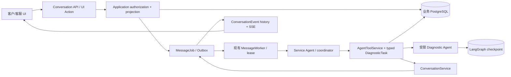

# 实施计划（A–D 功能代码已实现；生产验收与运营补齐待办）

**状态**：用户批准的 Tool Subagent 方案已按 A–D 交付代码。具体代码、命令及证据见 `progress.md`；阶段不因设计目标而自动算完成，未验收项单列。

## 阶段状态、文件与影响

| 阶段 | 实际修改范围/契约 | 数据与接口 | 延迟、风险与验收情况 |
|---|---|---|---|
| A. 委派与结构化结果（代码完成） | `agents/runtime.py`、`agents/diagnostic.py`、`application/agent_services.py`、`application/diagnostic_contracts.py`、models、测试 | migration 0015；无新 HTTP 路由。typed task/result、受限手册/Skill 工具和 lease fence | 符合当前锁定 LangChain API；只在主 Agent 选择时增加专家模型调用/可能的综合调用。隔离 PostgreSQL与契约/运行时测试通过；真实 Provider未测。 |
| B. 活动可见（代码完成） | `application/services.py` 与诊断 contracts、前端 SSE/Workspace/活动卡、worker/browser tests | `specialist.activity` 复用 Outbox、ConversationEvent、sequence、PUBLIC/INTERNAL 和历史 SSE，无新路由 | 真实状态事件只提升可感知性，不减少模型 wall-clock；策略重查、内部事件客户不可见、刷新恢复、假设身份测试通过。 |
| C. 提问/回答/恢复（代码完成） | UI Catalog/Renderer、UIAction application service、AgentContextBuilder/Runtime、models、tests | migration 0016；复用 `DIAGNOSTIC_TASK_VIEW`/`SUBMIT_DIAGNOSTIC_ANSWER`、现有 UI action endpoint 与 MessageJob。没有独立 Task API。 | 用户等待不持有旧 Worker lease；回答会开始新的 AgentRun/专家调用。授权、幂等、旧版本、期限、持久恢复有定向测试；hard kill/provider state恢复未测。 |
| D. SOP/协作/知识/来源（业务边界代码完成，staff provenance UI未做） | 经验候选构造与来源重验，安全/转人工路径，ConversationService 固定发布，现有 SOP/核验边界 | 不建新事实表/路由；结果仍 HYPOTHESIS；SAFETY_STOP/HUMAN_REVIEW -> WAITING_STAFF | 检索资料/经验仍需人工可见的细粒度来源审查界面；Case/Device 不由模型修改。安全与 policy 单测通过。 |

## 当前核心架构

依赖方向：transport/Renderer → Application Service + authorization → domain/persistence；Worker → AgentRuntime；Agent → typed read-only application services；仅 ConversationService 发布 Conversation Message、UI 和事件。Checkpoint 是执行状态，不是业务状态。Device Passport、Service Case、Conversation、AgentRun、真人 ServiceTask 和 DiagnosticTask 生命周期保持分离。

## 关键契约与失败策略

- `DiagnosticTaskInput v1` 由服务器生成，包含授权资源版本、有限 history 和最多两条审核经验候选；Diagnostic Agent 仅可查本地只读手册/eligible Skill。
- `DiagnosticResult v1` `certainty=HYPOTHESIS`，引用必须属于获准输入/已校验手册来源；只保存诊断假设，不写已核验 DeviceFact 或 Case 状态。
- 专家活动事件固定身份与状态，仅输出已允许阶段摘要；当前 reply policy 在 dispatch 复核。内部 Tool Result、prompt、raw trace 不进入公开事件/UI。
- 问题投影由现有 UI Document 提供；`UIActionRequest.input` 是 `{task_version, question_revision, answer}`。答案以 DiagnosticAnswer + Message + MessageJob + UIActionInvocation + Outbox 原子落库。新 answer AgentRun 从持久业务状态重建；同 Worker lease retry 复用 SpecialistRun checkpoint thread。
- task owner、tenant、resource versions、lease、question revision、client action key、UI revision 和 reply policy 均在 server 校验。答案重放幂等；冲突/过期/越权拒绝。不把普通消息自动绑定等待 task。
- 7 天期限在授权 projection/answer 校验时懒过期，尚无后台 scheduler。故障返回固定 fallback/人工审查，不输出推理或伪造完成。

## 取舍和剩余决策

采用 manager-controlled Tool Subagent，Service Agent 始终对用户统一并负责收口。当前依赖不安装 OpenAI Agents SDK/Microsoft Agent Framework，不迁移 AG-UI，不建通用 Registry、Agent 微服务或独立诊断 API。SOP 仍是确定性业务规则与服务；知识是手册、审核经验和固定 Skill；Jev 搁置，当前无向量 RAG 平台。

剩余未解决事项：是否需要后台期限扫描/通知；客服 provenance review card 的信息粒度与 UI；生产 Provider 的实际延迟/成本门槛；强制终止模型/Worker 进程后的 checkpoint fallback 验收。若后续变成多分支并行 workflow，再单独评估 LangGraph custom workflow；当前不为多 Agent 扩框架。

## 分阶段验收后续路线

1. 完成本地和 CI 全量/定向回归、OpenAPI/client drift、浏览器权限路径和迁移回滚核对。
2. 在批准的真实 Provider 环境采集简单请求与委派请求 P50/P95、TTFT、首个真实事件、调用数/token；质量与拒答路径做小样本验收。
3. 另开客服来源审查 UI 与过期 scheduler 的明确需求/验收；未交付前不宣称这些能力可用。

详见 `tasks.md`、`research.md` 和 `contracts/feature-contract.md`。
